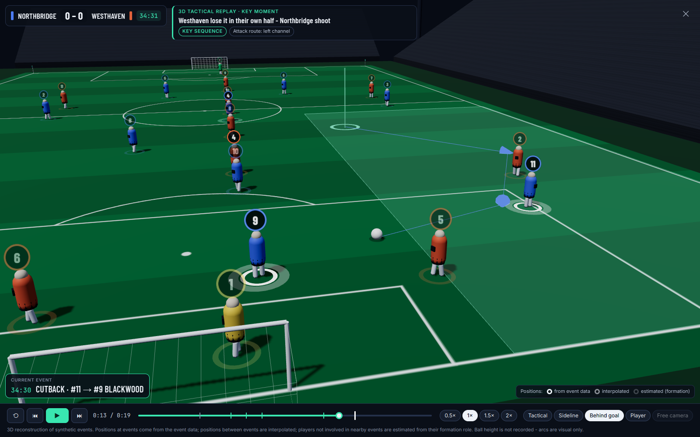
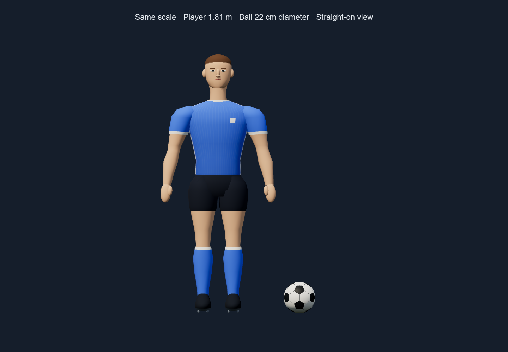
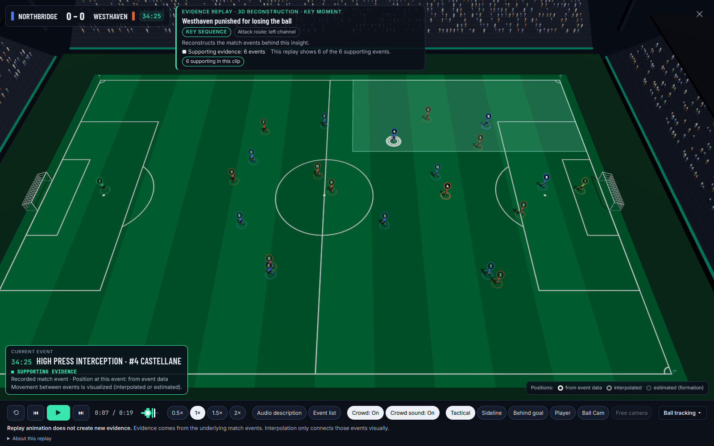
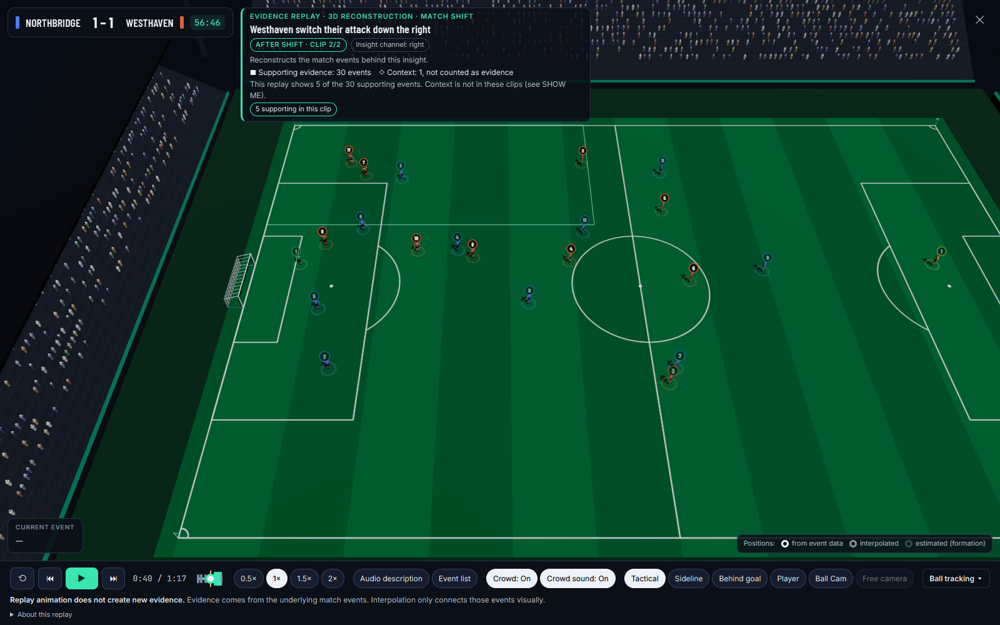

# MatchShift

**Football intelligence you can question, verify, and replay.**

MatchShift turns synthetic, football-realistic match events into insights about meaningful changes in play. Deterministic C# analytics decide what happened and attach the evidence; Microsoft Agent Framework agents on Microsoft Foundry interpret, adapt and verify those grounded facts. **AI does not decide what happened in the match. The match data does.** Viewers follow **WHY? → SHOW ME → Evidence Replay** to inspect the reasoning, source events and a visual reconstruction.

[Hosted app](https://matchshift-pd.azurewebsites.net/) · [Judge demo](https://matchshift-pd.azurewebsites.net/?demo=judge) · [Source repository](https://github.com/pdidow/MatchShift)

The Azure App Service-hosted app is live-capable. `?demo=judge` uses previously recorded real Agent Framework / Foundry workflows; viewing that path starts no live Foundry run, and insights without recordings never fall back to live execution. Local use needs no cloud credentials.

> ### ⚠️ ALL football data in MatchShift is synthetic.
> Every club, player, match, event, score, lineup, substitution and tactical pattern is fictional and
> generated by MatchShift's own seeded simulator. No live Premier League data, real player statistics,
> scraped websites, paid sports APIs or proprietary feeds are used anywhere.

Built for the Microsoft + Premier League **"Inside the Game" Developer Hackathon**.

See the [judge walkthrough](docs/JUDGING.md), [local and optional live setup](docs/FOUNDRY.md), and [evaluation results](docs/EVALUATION.md).

MatchShift watches a stream of football-realistic synthetic events and, live, answers:

| Question | How |
|---|---|
| **What happened?** | Incremental match state: possessions, attacks, losses, shots, substitutions |
| **What changed?** | 12 shift detectors + key-moment detection with thresholds, sample minimums, persistence and cooldowns |
| **Why does it matter?** | Importance model, highlight ranking, recap story beats |
| **What evidence supports it?** | Every insight carries structured evidence: windows, before/after values, thresholds, sample sizes, z-scores, supporting event IDs |
| **How should this viewer hear it?** | Five viewer modes × six languages (EN/FR/ES/DE/IT/PT); grounded agent narration or offline templates |
| **What story is emerging?** | Live narrative cards, highlight timeline, half-time and full-time recaps in four styles |


## 60-Second Judge Demo

Open the [judge demo](https://matchshift-pd.azurewebsites.net/?demo=judge), or choose **Guided demo · 60 s** in the top bar. This path uses the real synthetic match events and previously recorded real agent results, with no live Foundry run. The eight-step guide overlays ordinary product controls; close it at any time.

1. **Intro.** Meet MatchShift and the flagship match.
2. **Built for every viewer.** The guide outlines the real Language menu and Accessibility button and names the six
   languages (English, Français, Español, Deutsch, Italiano, Português). It also lists the Accessibility Center's
   options: spoken insights, audio match mode, replay audio description, captions, high contrast, colour vision,
   reduced motion and flashing, text size, simplified insights and keyboard navigation. *Open Accessibility Center*
   opens the real panel. The guide never changes a language or a setting itself.
3. **Jump to the flagship moment.** The flagship match pauses at 64:00. The selected insight: at 63' Westhaven
   switch their attack down the right after a substitution (31% → 90%), detected by deterministic C# analytics.
4. **WHY?** shows the exact metric, windows, threshold, sample and confidence, computed from match events.
5. **SHOW ME** draws the 30 supporting source events on the pitch. One more attack, the only recent one that did not
   use the right channel, is drawn grey for comparison and labelled as context, not counted as evidence.
6. **EVIDENCE REPLAY** visualizes selected evidence in 3D, before and after the shift, with event-data, interpolated and estimated positions distinguished. The flagship clip shows 5 of 30 supporting events; its context event is not in the clip.
7. **Agents** shows the recorded Microsoft Agent Framework workflow:
   - Tactical Analyst first;
   - then Audience Narrative and Accessibility Narrator in parallel;
   - then the Verification Agent.

   Code validates before and after the AI. I015 displays **RECORDED DEMO** and its real **APPROVED WITH CHANGES** result.
8. **Trust / Verification.** The workflow verdict (APPROVED / APPROVED WITH CHANGES / REJECTED) and Microsoft Foundry Evaluations proof. The latest EN/FR/ES run evaluated 39 rows, including 28 published outputs and 11 injected defects. Published-output averages: groundedness 4.89/5, relevance 4.93/5, coherence 4.11/5. Injected defects caught:
   - deterministic validator 11/11;
   - Verification Agent 11/11;
   - Foundry groundedness 5/11.

**RECORDED DEMO** replays the real result of a prior verified workflow. **OFFLINE TEMPLATE** makes no model call and is not AI-verified. Normal hosted use remains live-capable.
Insight used: `MS-FLAGSHIP-001-I015`.

The submission video's [English captions and transcript](docs/video/) and [audio and voice credits](docs/VIDEO_CREDITS.md) are available in the repository.

## Languages

MatchShift currently supports English, French, Spanish, German, Italian and Portuguese (European Portuguese, pt-PT)
across localized UI and narration, using available browser/device voices with graceful fallback. Speech uses the
browser's own text-to-speech: if a device has no voice for a language, the text is still shown, the utterance keeps the
correct language tag and a localized notice explains it. Not every browser or device has a native voice for every
language. The language list lives in one place on each side (`src/MatchShift.Web/src/languages.ts` and
`LexiconRegistry`), and tests check they match.

## The core principle

**AI does not decide what happened in the match. The match data does.** Deterministic C# computes each count, window, share, index and detection, then freezes a grounded `InsightContext`. The Tactical Analyst interprets it; Audience Narrative and Accessibility Narrator adapt it in parallel. Code validates grounding, the Verification Agent reviews the candidate, and final deterministic validation decides what can be published. Outcomes are APPROVED, APPROVED WITH CHANGES or REJECTED. The older optional editorial/recap provider is documented separately in [FOUNDRY.md](docs/FOUNDRY.md).

```
synthetic events → deterministic analytics → grounded InsightContext → Tactical Analyst
  → Audience Narrative + Accessibility Narrator (parallel) → deterministic grounding validation
  → Verification Agent → final deterministic validation → APPROVED / APPROVED WITH CHANGES / REJECTED
```

## What is in the box

- **Synthetic data engine** - possession-based simulator with its own xoshiro256** PRNG (same seed ⇒ same
  match on every machine), fictional clubs and behaviour profiles, a scripted **flagship match**, seven
  labelled scenario families, and batch dataset generation with ground truth kept *outside* the event stream.
- **Explainable analytics** - attack sides, entries, chance quality, possession, field tilt, tempo,
  transitions, plus three transparent composite indices: **MatchShift Pressure Index**, **Match Control**,
  **Control-vs-Chaos**. All formulas documented; none is an official statistic.
- **MatchShiftDetector** - live, no-look-ahead detection of ATTACK_CHANNEL_SHIFT, PRESSURE_INCREASE/DECREASE,
  CONTROL_SHIFT, TERRITORIAL_SHIFT, POSSESSION_SHIFT, TEMPO_SHIFT, CHAOS_INCREASE, SHOT_PRESSURE,
  TURNOVER_SPIKE, POST_SUBSTITUTION_CHANGE, COUNTER_ATTACK_THREAT, PASSING_STYLE_SHIFT and moments (GOAL, BIG_CHANCE,
  DANGEROUS_TURNOVER) - **measured** against labelled scenarios (see [detection](docs/MATCH_SHIFT_DETECTION.md)).
- **WHY?** and **SHOW ME** - every card opens its evidence table, and draws exactly the events behind it on the pitch.
- **Evidence Replay** - insights can show a selected Three.js clip from their evidence
  (BEFORE / AFTER clips for tactical shifts), with tactical overlays and four camera views. See below.
- **Microsoft Agent Framework multi-agent workflow** - four code-first agents on Microsoft Foundry (Tactical Analyst →
  concurrent Audience Narrative + Accessibility Narrator → Verification Agent) in a `WorkflowBuilder` graph with shared
  workflow state, fan-out/fan-in, deterministic validation before and after the verifier, bounded recovery, and a live
  topology + trace in the Agents tab. See [agents](docs/AGENTS.md).
- **Player focus and passing** - analyst passing totals, long-ball-share shift detection, player summaries with
  event IDs and timelines, and player-related insights ranked first.
- **Broadcast Preview** - `/broadcast` previews broadcast-style graphics over synthetic event animation; `/overlay` is the cleaner transparent graphics output. Neither route transmits video. Independent session IDs keep viewer controls separate.
- **Broadcast UI** - React + TypeScript: live pitch, insight feed, momentum and pressure charts, highlight
  scrubber, playback at 1x/2x/5x/10x with seeking, recaps, language and viewer-mode switching.
- **Microsoft stack** - Azure App Service hosts the app; Microsoft Agent Framework uses Microsoft Foundry `gpt-4.1-mini` through managed identity. Foundry Evaluations measures output quality. Application Insights (OpenTelemetry) and Fabric-ready exports (JSONL / CSV / Parquet) are also present. Container Apps definitions are an alternative deployment option, not the current host.

## Evidence Replay (3D reconstruction)

Every insight card, the WHY? panel, the SHOW ME bar and the highlight timeline offer **EVIDENCE REPLAY**: an
interactive visualization of selected evidence clips, rendered with Three.js inside the app. For I015, the insight has **30 supporting events and 1 context event**, but the current clip shows **5 of the 30 supporting events** and no context event. Context is not evidence. Replay animation does not create new evidence: player positions come from event data, are interpolated between observations, or are estimated from formation and event context. Illustrative positions are not tracking data. Camera changes alter presentation only.

Evidence Replay includes an optional lightweight stadium crowd. Spectators are a decorative layer and can be switched
off manually (**Crowd: On/Off**, remembered on this device).
- **Hardware-aware:** three internal levels.
  - **NORMAL**, with reactions, only when the browser reports clearly capable hardware: WebGL2, 8+ cores, 8+ GB, a
    texture limit of 8192+, a known hardware GPU and no more than a 4K frame.
  - **LOW**, a lighter reactive crowd, for unknown or modest hardware. A missing signal never counts as capable.
  - **OFF** with no WebGL2, a software renderer, under 4 GB or under 4 cores.
  - Turning the crowd on never forces NORMAL onto weak hardware.
- **Frame-time guard:** a one-off check after the crowd appears. If frames are sustained-slow it steps NORMAL → LOW,
  then LOW → OFF, never back up, with a polite notice ("Crowd reduced…" / "Crowd disabled to maintain replay
  performance."). A crowd you switched on yourself is only reduced if the replay becomes hard to use.
- **Cosmetic only:** the crowd never touches evidence. Supporting and context events, flags, counts and the timeline are
  unchanged, and tests guard this. Its optional sound (below) is atmosphere only and never information.
- **Spectators read as people:** stadium-scale low-poly figures, not character models.
  - NORMAL: a torso wider at the shoulders and a round head on a short neck gap (32 triangles). A second, cheering
    pose has both arms raised in a V (44 triangles).
  - LOW: the same torso with a small block head (24 triangles).
  - Heads and raised arms get a skin tone; clothing uses a restrained palette that stands out from the dark stands.
- **Cheap to draw:** instanced meshes only, with no shadows.
  - NORMAL: 2,216 spectators, 4 crowd draw calls at rest (about 71k triangles) and 8 at a reaction peak (about 85k).
  - LOW: 987 spectators, 4 draw calls, about 24k triangles.
- **Stays clear of the play:** seats start 4 m back from each stand front, behind the sideline and behind-goal cameras.
- **Reactions are a short wave, not one block.** Each stand's spectators are split into seeded reaction cohorts:
  loose patches, mostly by position along the stand, reacting in a shuffled order. NORMAL has 8 cohorts per stand;
  LOW has 3.
  - Later cohorts start later (a goal spreads its onsets over about 0.35 s) and settle sooner, so the crowd rises and
    settles in waves. The four stands also start 0-0.23 s apart.
  - Every spectator's own phase is computed on the GPU from the replay time and its cohort, so pause, seek, restart
    and clip changes follow the replay clock exactly. There are no timers.
  - **Goal (NORMAL):** about half the crowd raise their arms, 10-25% stand and the rest lean slightly. The reaction is
    over by about 2.5 s.
  - **Shot:** a few cohorts, roughly 15-20% raise their arms, for about 1.1 s.
  - **Interceptions, high recoveries and turnovers:** one or two groups half-stand for about 0.6 s.
  - **Passes and carries:** no reaction.
  - Cheering cohorts always form a fixed, pre-sorted group. Each stand keeps a neutral and a cheering mesh, so a
    reaction only changes two instance counts. Nothing is allocated and no spectator is updated on the CPU.
  - The four stands also differ slightly in strength and cheering share, deterministically. No allegiance is implied.
  - **LOW reacts more simply:** three cohorts rise (about 0.45 m for a goal, less for shots, nothing for turnovers),
    with no cheering pose.
  - Nothing moves with Reduced motion, on OFF, or after the guard has switched the crowd off.
- **Optional crowd sound (Crowd sound: On/Off, remembered; default On).** Decorative atmosphere only: it never carries
  information that is not on screen and in the narration.
  - Clips: a goal roar with applause (2.4 s), a smaller "ooh" for shots (1.25 s, at 45-60%), a faint stir when the
    ball is won high up the pitch (0.8 s, at 18-20%). Passes, carries and anything else are silent.
  - The goal clip is a trimmed, normalized excerpt of a real crowd recording released under CC0 (Freesound 763816 by
    ShangusBurger / Shane Vincent; see [docs/THIRD_PARTY_ASSETS.md](docs/THIRD_PARTY_ASSETS.md)). The chance and
    murmur clips are synthesized for MatchShift. No broadcast audio, chants or music, and nothing that could pass for
    a referee's whistle.
  - Each clip is loaded and decoded once when the replay opens. A clip plays when the replay clock crosses its event,
    once per pass. Pause, a seek of any size, a restart or a clip change fade the current clip out; skipped events
    never play.
  - Narration always wins. Crowd sound plays through Web Audio, never speech, so it cannot delay, interrupt or cancel
    narration. While narration speaks it drops to 20% of its level, and to 60% while audio description is on but quiet.
    Even a goal sits well below speech.
  - Nothing plays while the crowd itself is off; the sound preference is kept for when it comes back. Reduced motion
    does not mute it.

Performance and evidence come first; the crowd only adds atmosphere.



**Why reconstruction.** The synthetic event stream records where each *event* happens (the passer, the pass
destination, the interception point, the shot), not continuous tracking of all 22 players. MatchShift therefore
reconstructs the scene - and says so.

**From evidence to sequence** (`MatchShift.Analytics.Replay.ReplayBuilder`, server-side and unit tested):

1. The insight's supporting and visual event IDs are grouped into possessions; the most telling one (shots, goals,
   box entries, regains, evidence count) becomes the clip, padded backwards to include the turnover that started it.
2. Tactical shifts (attack channel, post-substitution, control, territory, possession, tempo, passing style) get two
   clips: **BEFORE SHIFT** - a typical attack from the baseline window - and **AFTER SHIFT** from the recent window.
3. Events keep their match seconds; passes and carries end when the next action starts.
4. The ball follows recorded start/end points; between actions it stays with its holder. Ball height is not in the
   data, so arcs on long balls, crosses and shots are drawn as visual aids only.

**Observed vs reconstructed positions.** Every player sample carries a provenance:

| Provenance | Meaning | Shown as |
|---|---|---|
| `ACTUAL_EVENT_POSITION` | recorded in an event (actor, pass destination, interception point...) | bright ring |
| `INTERPOLATED_POSITION` | between two nearby recorded positions, or blending towards one | half-opacity ring |
| `ESTIMATED_POSITION` | not near any event: the player's anchor shifted with the ball - illustrative only | faint ring |

**Works with any data in MatchShift's event model** - nothing is specific to the demo match. A player's anchor is
their own observed event positions so far in the match, blended with a standard spot for their role (team-mates sharing
a role are spread across the pitch). A generator-supplied behaviour profile is used only if present, so a feed with
no profiles still produces a sensible shape (tested by stripping every profile from the flagship match).

**Tactical overlays** come from the insight: the insight's channel (or the attack route actually taken), the
attacking third for pressure/territory insights, ball-winning players in the press (pulsing), the turnover and shot
locations, and the pass route drawn as the ball travels. The current event is captioned (e.g.
`34:25 HIGH PRESS INTERCEPTION · #4 CASTELLANE`) and its players are highlighted.

**Cameras:** Tactical (default, high angled, whole pitch), Sideline (TV-style, follows the ball), Behind goal (behind
the goal being attacked), Player (follows the key player). Drag to orbit, scroll to zoom, right-drag to pan; *Reset
camera* returns to the preset. A short fly-in plays the first time (skippable).

**Player and ball models:** articulated human proportions, faces, numbered shirts and boots, plus a curved
32-panel football with recessed seams. Players share geometry: 4,488 triangles nearby and 1,736 at distance,
with one draw call per player body. The ball represents a 22 cm diameter; the same display scale is applied to
players and ball. All models and textures are generated locally, with no external asset downloads.



**Playback:** play/pause, restart, previous/next event, a scrubber with event markers (evidence events highlighted,
clip boundaries marked), 0.5× / 1× / 1.5× / 2×. Keyboard: space, ←/→, 1-4, Esc.

**Why it helps explainability:** WHY? shows the numbers, SHOW ME shows supporting events in 2D, and Evidence Replay visualizes a selected clip in space and time, with reconstructed positions labelled as such.

**Try it:** run the app, seek past 35', open the **Key moment** card "Westhaven lose it in their own half - Northbridge
shoot" (35') and press **3D REPLAY**: Westhaven play out from the back, Northbridge's press intercepts, and they score
straight through the left channel. For a BEFORE/AFTER example, use the 63' **Match shift** card. Deep link (same
session): `/?session=<id>&replay=MS-FLAGSHIP-001-I005` (optional `&replayAt=7&replayCam=sideline&replayPause=1`).

| Tactical view | After the shift (63' channel insight) |
|---|---|
|  |  |

## Accessibility (optional, user-controlled)

The default MatchShift experience is the standard match view. **Accessibility adaptations are opt-in**: open
**Accessibility** in the top bar to pick a preset (Low vision, Audio-first, Reduced motion) or switch on individual options:

- **Speech and audio:** spoken insights at three detail levels, an audio match mode, spoken recaps, 3D replay audio
  description, READ EXPLANATION and READ WHAT CHANGED in WHY?, DESCRIBE THIS in SHOW ME, and optional sound cues.
- **Text:** captions and a replayable transcript.
- **Display:** high contrast, colour-vision modes (validated palettes plus shapes, dashes and hatching), and larger text.
- **Motion:** reduced motion (follows the OS by default; direct camera cuts in 3D) and reduced flashing.
- **Content:** simplified insights.

Speech follows the match clock: MatchShift speaks less, not later. Each cue is dropped once the match has moved past
it, at most one cue waits per source, and critical news interrupts. Faster playback means fewer, shorter cues; the
speech rate is never sped up. Evidence Replay pauses the match and takes exclusive audio focus while it is open, then
narrates against the replay clock. Speech is generated only from the deterministic evidence. Keyboard navigation, focus management and selective screen-reader live regions are
built in for everyone; press **?** for shortcuts. Details, keyboard map and test plan: [docs/ACCESSIBILITY.md](docs/ACCESSIBILITY.md).

## Quick start (no keys, no cloud)

Requirements: **.NET SDK 10**, **Node 22.12+** (Node 22 is used by CI and Docker).

```bash
# 1. API (serves on http://localhost:5002)
dotnet run --project src/MatchShift.Api --launch-profile http

# 2. UI with hot reload (http://localhost:5173, proxies /api to :5002)
cd src/MatchShift.Web
npm ci
npm run dev
```

Or build the UI into the API and run a single process:

```bash
cd src/MatchShift.Web
npm ci
npm run build                                      # outputs to src/MatchShift.Api/wwwroot
cd ../..
dotnet run --project src/MatchShift.Api --launch-profile http   # open http://localhost:5002
```

Or Docker: `docker build -t matchshift . && docker run -p 8080:8080 matchshift` → http://localhost:8080

Press **Play**. 1x = 30 match-seconds per real second (a full match in 3 minutes); 2x is the demo default.

## Tests and evaluation

```bash
dotnet build                                              # build the .NET solution
dotnet test                                               # .NET regression suite
dotnet run --project tools/MatchShift.Cli -- evaluate --matches 120   # detector precision/recall vs ground truth
dotnet run --project tools/MatchShift.Cli -- robustness   # flagship script re-simulated with 20 other seeds
dotnet run --project tools/MatchShift.Cli -- analyze      # live insights for the flagship match
dotnet run --project tools/MatchShift.Cli -- narrate --lang fr --mode TeachMe --recap Casual
dotnet run --project tools/MatchShift.Cli -- export --matches 50   # Fabric-ready dataset
dotnet run --project tools/MatchShift.Cli -- foundry-eval  # Foundry Evaluations: prints cost estimate; --confirm true runs it
```

Web regression checks, from `src/MatchShift.Web`: `npm test` and `npx tsc -b --noEmit`. `npm run build` performs type-checking and creates the production bundle.

AI output quality is checked in three layers:
- deterministic validation;
- an independent Verification Agent;
- Microsoft Foundry Evaluations (groundedness, relevance, coherence).

The latest real Foundry evaluation run covered 39 rows in English, French and Spanish, including 11 adversarial
defects. Published outputs averaged 4.89/5 groundedness. The deterministic layer caught 11 of 11 defects, the
Verification Agent 11 of 11, and Foundry groundedness 5 of 11. See [EVALUATION.md](docs/EVALUATION.md) and the
[latest report](docs/evaluations/latest.md).

## Optional: Microsoft Foundry and Azure

**Hosted:** MatchShift runs on Azure App Service (Free F1). Its system-assigned managed identity lets the
Microsoft Agent Framework workflow call Microsoft Foundry (`gpt-4.1-mini`) with no keys. Locally, the same workflow
authenticates with the Azure CLI. See [DEPLOYMENT.md](docs/DEPLOYMENT.md) for setup, the required role and the
judge walkthrough.

For an offline demonstration of the provider workflow:

```powershell
dotnet run --project src/MatchShift.Api --launch-profile http -- --Narration:Provider=mock
```

Use `--Narration:Provider=template` for deterministic templates. No credentials are required in either
mode. [FOUNDRY.md](docs/FOUNDRY.md) documents endpoint/deployment settings and optional authentication
when access is available, plus repeatable mock validation. [MICROSOFT_INTEGRATION.md](docs/MICROSOFT_INTEGRATION.md)
describes the optional Azure deployment definitions; no deployment is required for local work.

## Repository layout

```
MatchShift.sln
src/
  MatchShift.Core            Domain: events, teams, players, pitch conventions, insight/evidence/story models
  MatchShift.SyntheticData   Seeded simulator, fictional clubs, flagship + labelled scenarios, datasets
  MatchShift.Analytics       MatchState, window metrics, indices, detectors, live analyzer, highlights, recaps
  MatchShift.Agents          Narrative engine (EN/FR/ES/DE/IT/PT lexicons, viewer modes), agents, verification
  MatchShift.Infrastructure  Microsoft Foundry provider, DI, dataset exporter, detector evaluator
  MatchShift.Api             ASP.NET Core minimal API, playback engine, SSE stream, telemetry
  MatchShift.Web             React + TypeScript + Vite broadcast UI
tests/                       xUnit: Core, SyntheticData, Analytics, Agents (+ narratives, export, Foundry), Api
tools/MatchShift.Cli         Inspect, calibrate, analyze, evaluate, sweep, export, narrate, agent-workflow, foundry-eval
tools/MatchShift.Evaluation  Microsoft Foundry Evaluations: live dataset, adversarial set, Evals API client, report
infra/                       Bicep for Azure Container Apps (+ App Insights, ACR, Foundry access)
docs/                        Design documentation
```

## Documentation

[Architecture](docs/ARCHITECTURE.md) · [Synthetic data](docs/SYNTHETIC_DATA.md) · [Analytics](docs/ANALYTICS.md) ·
[Match shift detection](docs/MATCH_SHIFT_DETECTION.md) · [Explainability](docs/EXPLAINABILITY.md) ·
[Agents](docs/AGENTS.md) · [Evaluation](docs/EVALUATION.md) · [Narratives](docs/NARRATIVES.md) · [Recaps](docs/RECAPS.md) ·
[Microsoft integration](docs/MICROSOFT_INTEGRATION.md) · [Demo under two minutes](docs/DEMO.md) · [Hackathon mapping](docs/HACKATHON.md) ·
[Compliance audit](docs/COMPLIANCE.md) · [Judge instructions](docs/JUDGING.md) ·
[Claims and upgrades](docs/CLAIMS_AND_UPGRADES.md) · [Project description](docs/PROJECT_DESCRIPTION.md) ·
[Accessibility](docs/ACCESSIBILITY.md)

---

All clubs and players are fictional; any resemblance to real clubs or people is coincidental.
MatchShift metrics (Pressure Index, Match Control, Chaos, Chance Quality) are MatchShift-derived and are
not official Premier League statistics.
