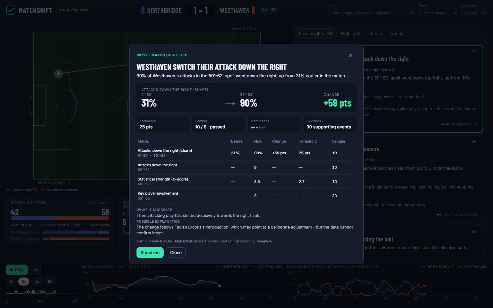
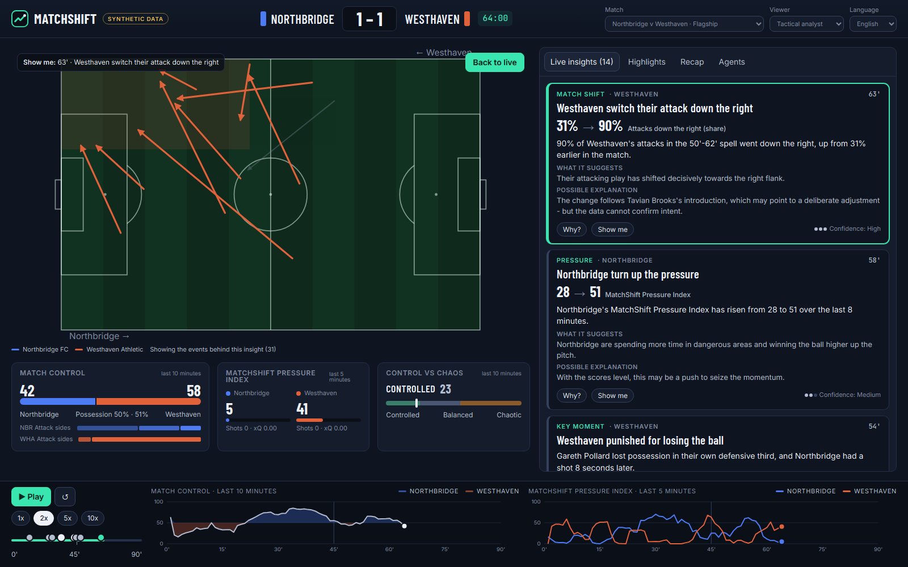
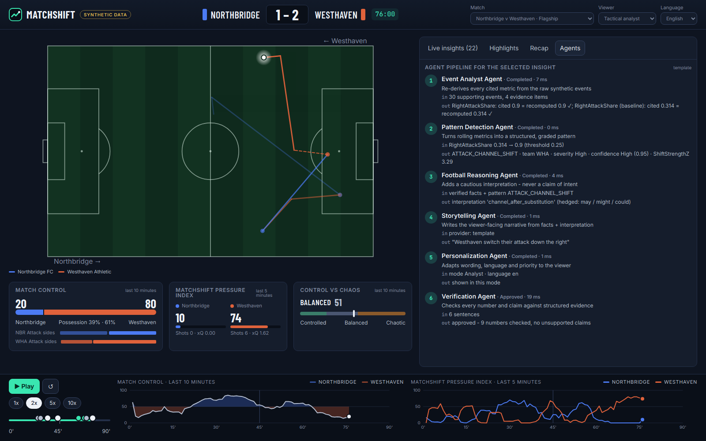
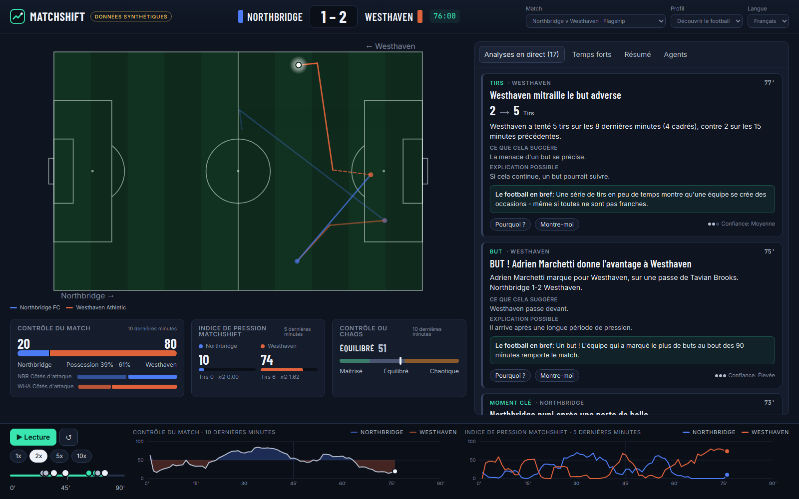

# MatchShift

**Football intelligence that explains itself.**

> ### ⚠️ ALL football data in MatchShift is synthetic.
> Every club, player, match, event, score, lineup, substitution and tactical pattern is fictional and
> generated by MatchShift's own seeded simulator. No live Premier League data, real player statistics,
> scraped websites, paid sports APIs or proprietary feeds are used anywhere.

Built for the Microsoft + Premier League **"Inside the Game" Developer Hackathon**.

MatchShift watches a stream of football-realistic synthetic events and, live, answers:

| Question | How |
|---|---|
| **What happened?** | Incremental match state: possessions, attacks, losses, shots, substitutions |
| **What changed?** | 11 shift detectors + key-moment detection with thresholds, sample minimums, persistence and cooldowns |
| **Why does it matter?** | Importance model, highlight ranking, recap story beats |
| **What evidence supports it?** | Every insight carries structured evidence: windows, before/after values, thresholds, sample sizes, z-scores, supporting event IDs |
| **How should this viewer hear it?** | Five viewer modes × three languages (EN/FR/ES), template or Microsoft Foundry wording |
| **What story is emerging?** | Live narrative cards, highlight timeline, half-time and full-time recaps in four styles |



| SHOW ME - only the attacks behind the insight | Agents - every step traced and verified | Teach me football, in French |
|---|---|---|
|  |  |  |

## The core principle

**The LLM never calculates match statistics.** Deterministic C# computes every count, window, share,
index and detection and attaches the evidence *before* any words exist. Language - template or AI -
only explains, personalises and translates verified facts. A mandatory **Verification Agent** checks
every number in every generated sentence against the evidence and rejects claims of intent; rejected AI
text is replaced by verified template text, so the demo never depends on a cloud service.

```
synthetic events ──► MatchState ──► window metrics ──► detectors ──► Insight (semantic + evidence)
                                     Pressure / Control / Chaos            │
                                                                            ▼
                             viewer profile ──► Storytelling / Personalization ──► Verification ──► UI
                                                (templates or Microsoft Foundry)
```

## What is in the box

- **Synthetic data engine** - possession-based simulator with its own xoshiro256** PRNG (same seed ⇒ same
  match on every machine), fictional clubs and behaviour profiles, a scripted **flagship match**, six
  labelled scenario families, and batch dataset generation with ground truth kept *outside* the event stream.
- **Explainable analytics** - attack sides, entries, chance quality, possession, field tilt, tempo,
  transitions, plus three transparent composite indices: **MatchShift Pressure Index**, **Match Control**,
  **Control-vs-Chaos**. All formulas documented; none is an official statistic.
- **MatchShiftDetector** - live, no-look-ahead detection of ATTACK_CHANNEL_SHIFT, PRESSURE_INCREASE/DECREASE,
  CONTROL_SHIFT, TERRITORIAL_SHIFT, POSSESSION_SHIFT, TEMPO_SHIFT, CHAOS_INCREASE, SHOT_PRESSURE,
  TURNOVER_SPIKE, POST_SUBSTITUTION_CHANGE, COUNTER_ATTACK_THREAT and moments (GOAL, BIG_CHANCE,
  DANGEROUS_TURNOVER) - **measured** against labelled scenarios (see [detection](docs/MATCH_SHIFT_DETECTION.md)).
- **WHY?** and **SHOW ME** - every card opens its evidence table, and draws exactly the events behind it on the pitch.
- **Multi-agent pipeline** - Event Analyst (re-derives cited metrics from raw events), Pattern Detection,
  Football Reasoning, Storytelling, Personalization, Recap and Verification agents with a visible trace.
- **Broadcast UI** - React + TypeScript: live pitch, insight feed, momentum and pressure charts, highlight
  scrubber, playback at 1x/2x/5x/10x with seeking, recaps, language and viewer-mode switching.
- **Microsoft stack** - Microsoft Foundry (keyless via managed identity), Azure Container Apps, Application
  Insights (OpenTelemetry), Fabric-ready exports (JSONL / CSV / Parquet), GitHub Actions, `azd up`.

## Quick start (no keys, no cloud)

Requirements: **.NET SDK 10**, **Node 20+**.

```bash
# 1. API (serves on http://localhost:5002)
dotnet run --project src/MatchShift.Api --launch-profile http

# 2. UI with hot reload (http://localhost:5173, proxies /api to :5002)
cd src/MatchShift.Web && npm install && npm run dev
```

Or build the UI into the API and run a single process:

```bash
cd src/MatchShift.Web && npm install && npm run build   # outputs to src/MatchShift.Api/wwwroot
dotnet run --project src/MatchShift.Api --launch-profile http   # open http://localhost:5002
```

Or Docker: `docker build -t matchshift . && docker run -p 8080:8080 matchshift` → http://localhost:8080

Press **Play**. 1x = 30 match-seconds per real second (a full match in 3 minutes); 2x is the demo default.

## Tests and evaluation

```bash
dotnet test                                               # ~200 xUnit tests (core, data, analytics, agents, API)
dotnet run --project tools/MatchShift.Cli -- evaluate --matches 120   # detector precision/recall vs ground truth
dotnet run --project tools/MatchShift.Cli -- robustness   # flagship script re-simulated with 20 other seeds
dotnet run --project tools/MatchShift.Cli -- analyze      # live insights for the flagship match
dotnet run --project tools/MatchShift.Cli -- narrate --lang fr --mode TeachMe --recap Casual
dotnet run --project tools/MatchShift.Cli -- export --matches 50   # Fabric-ready dataset
```

## Optional: Microsoft Foundry and Azure

Copy `.env.example` values into environment variables (or `appsettings`), e.g.
`Foundry__Enabled=true`, `Foundry__Endpoint=...`, `Foundry__Deployment=...` (API key optional - Entra ID by default).
Deploy with the Azure Developer CLI: `azd up` (provisions [infra/main.bicep](infra/main.bicep)).
See [docs/MICROSOFT_INTEGRATION.md](docs/MICROSOFT_INTEGRATION.md).

## Repository layout

```
MatchShift.sln
src/
  MatchShift.Core            Domain: events, teams, players, pitch conventions, insight/evidence/story models
  MatchShift.SyntheticData   Seeded simulator, fictional clubs, flagship + labelled scenarios, datasets
  MatchShift.Analytics       MatchState, window metrics, indices, detectors, live analyzer, highlights, recaps
  MatchShift.Agents          Narrative engine (EN/FR/ES lexicons, viewer modes), agents, verification
  MatchShift.Infrastructure  Microsoft Foundry provider, DI, dataset exporter, detector evaluator
  MatchShift.Api             ASP.NET Core minimal API, playback engine, SSE stream, telemetry
  MatchShift.Web             React + TypeScript + Vite broadcast UI
tests/                       xUnit: Core, SyntheticData, Analytics, Agents (+ narratives, export, Foundry), Api
tools/MatchShift.Cli         Inspect, calibrate, analyze, evaluate, sweep, export, narrate
infra/                       Bicep for Azure Container Apps (+ App Insights, ACR, Foundry access)
docs/                        Design documentation
```

## Documentation

[Architecture](docs/ARCHITECTURE.md) · [Synthetic data](docs/SYNTHETIC_DATA.md) · [Analytics](docs/ANALYTICS.md) ·
[Match shift detection](docs/MATCH_SHIFT_DETECTION.md) · [Explainability](docs/EXPLAINABILITY.md) ·
[Agents](docs/AGENTS.md) · [Narratives](docs/NARRATIVES.md) · [Recaps](docs/RECAPS.md) ·
[Microsoft integration](docs/MICROSOFT_INTEGRATION.md) · [Two-minute demo](docs/DEMO.md) · [Hackathon mapping](docs/HACKATHON.md)

---

All clubs and players are fictional; any resemblance to real clubs or people is coincidental.
MatchShift metrics (Pressure Index, Match Control, Chaos, Chance Quality) are MatchShift-derived and are
not official Premier League statistics.
