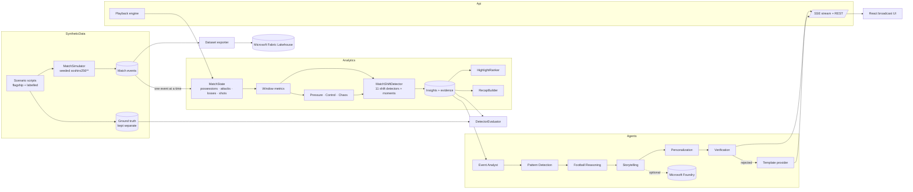

# Architecture

> All football data in MatchShift is synthetic.

## Principles

1. **Deterministic numbers, generative words.** C# computes every statistic and detection; language models
   (optional) only rephrase verified facts.
2. **Evidence before narrative.** An `Insight` is created with its evidence and supporting event IDs; text is
   rendered afterwards, per viewer, from that record.
3. **Live and honest.** The analyzer ingests events one at a time and evaluates at minute ticks using only events
   it has already seen. Replaying to minute *N* yields exactly the insights a live viewer had at *N* (tested).
4. **Runs offline.** Template narratives in three languages make the whole product work without keys or network.
   Cloud services strengthen it; they never block it.

## Components

| Project | Responsibility | Depends on |
|---|---|---|
| `MatchShift.Core` | Event/team/player model, pitch conventions, `Insight`, `EvidenceItem`, `Highlight`, `RecapFacts` | - |
| `MatchShift.SyntheticData` | Simulator, PRNG, clubs, flagship + scenario library, datasets, ground truth | Core |
| `MatchShift.Analytics` | `MatchState`, `MetricsCalculator`, indices, detectors, `LiveMatchAnalyzer`, highlights, recaps | Core |
| `MatchShift.Agents` | Lexicons, narrative rendering, viewer modes, recap narration, agents, verification | Core, Analytics |
| `MatchShift.Infrastructure` | Foundry client/provider, DI, Fabric exporter, detector evaluator | all of the above |
| `MatchShift.Api` | Minimal API, playback engine, SSE, telemetry | Infrastructure |
| `MatchShift.Web` | React UI | API over HTTP |

The analytics engine has **no reference** to `SyntheticData`: it cannot see scenario scripts or ground truth.
An adapter for an official hackathon schema only needs to produce `MatchEvent` records (see
[Synthetic data](SYNTHETIC_DATA.md#adapting-another-schema)).

## Live data flow

1. `PlaybackService` ticks every 125 ms; `DemoSession` advances the clock by `elapsed × 30 × speed` match-seconds.
2. Each event whose second has passed is fed to `LiveMatchAnalyzer.Ingest`; crossing a minute boundary first runs
   the detector tick (so a tick at minute *m* only sees events before *m*).
3. Moments (goal, big chance, dangerous turnover) are evaluated as each event arrives.
4. `GET /api/demo/stream` (Server-Sent Events) pushes a snapshot when the session version changes: clock, score,
   recent events in absolute coordinates, rolling metrics, timeline, insight cards rendered for the caller's
   profile, highlights. The UI falls back to polling `/api/demo/state` if SSE is blocked.
5. Seeking backwards rebuilds the analyzer from kick-off and replays - identical to having watched live.

## API

| Method | Path | Purpose |
|---|---|---|
| GET | `/api/meta` | languages, modes, recap styles, speeds, AI provider |
| GET | `/api/matches`, `/api/matches/{id}` | synthetic match catalogue and squads |
| POST | `/api/demo/reset` `{matchId?}` · `/play` · `/pause` · `/speed` `{speed}` · `/seek` `{minute}` | playback |
| GET | `/api/demo/state?lang&mode&team&player` | snapshot for a viewer profile |
| GET | `/api/demo/stream?...` | SSE snapshots |
| GET | `/api/demo/events?since=` · `/analytics` · `/insights` · `/highlights` | raw feeds |
| GET | `/api/demo/insights/{id}/evidence` | WHY? payload (raw + localised evidence) |
| GET | `/api/demo/insights/{id}/events` | SHOW ME payload (layers + events) |
| GET | `/api/demo/insights/{id}/agents` | run and trace the agent pipeline |
| GET | `/api/demo/recap/{halftime\|fulltime}?style&lang` | verified recap (409 until play reaches that point) |
| GET | `/health` | liveness |

## Pitch conventions

Stored coordinates are **team-relative**: X 0-100 from the acting team's own goal line to the opponent's,
Y 0-100 from that team's left touchline to its right. "Right-side attacks" therefore always means the attacking
team's right. The API converts to an **absolute** frame for drawing (home attacks left→right in both halves).
